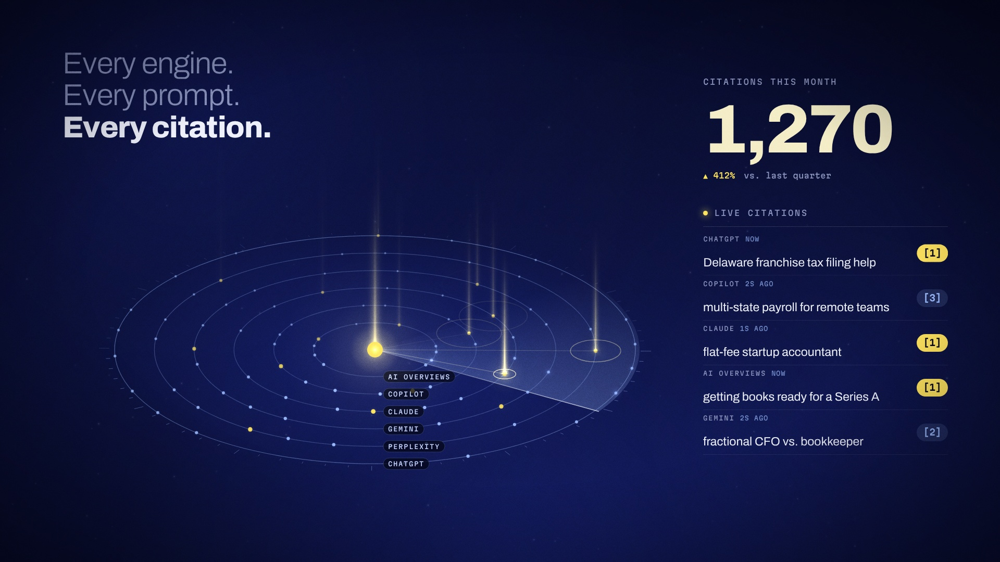

# Citelight — brand film

A 45-second motion piece for **Citelight**, a fictional SEO agency that tracks
how often AI assistants cite your brand. It ships as an interactive player and
as rendered video in two aspect ratios, with an original score synthesized to
the frame.

| | |
| --- | --- |
| `renders/citelight-16x9.mp4` | 1920×1080, 60 fps, with score |
| `renders/citelight-9x16.mp4` | 1080×1920, 60 fps, with score (Reels / Shorts / TikTok) |
| `renders/stills/` | key frames for decks and social |
| `index.html` | the live player: scrub, chapters, 16:9 ↔ 9:16, sound, full screen |



## The story

One point of yellow light, the citation, carries the film from scene to scene.

| Time | Scene | What happens |
| --- | --- | --- |
| 0:00 | **Question** | A customer asks an AI assistant for the best startup accounting firm. The answer streams in and cites three competitors. |
| 0:07 | **Shift** | *Search used to be ten blue links. Now it’s one answer. And AI decides who gets cited.* A highlighter swipes the last word. |
| 0:14 | **Mark** | The highlight collapses into a point of light; brackets snap around it to form the Citelight mark. |
| 0:19 | **Radar** | The light becomes the core of a tilted citation radar, with one ring per AI engine. As the sweep finds a citation, a beam rises, the counter ticks and the live feed updates. |
| 0:30 | **Proof** | The radar flattens edge-on into a chart baseline. The light draws AI share of voice from 4% to 31% and overtakes the competitor from the opening answer. |
| 0:38 | **Brand** | The light flies home, the brackets slam shut, and the wordmark resolves: *Be the source.* |

The radar doubles as a step sequencer. One rotation is two bars at 120 BPM, and
each cited prompt sits on a 16th-note slot, so every beam you see is a note you
hear. The second rotation wins six more prompts, and the melody fills out.

## Run the player

It's static. Serve this folder with anything:

```bash
python3 -m http.server 8000      # → http://localhost:8000
```

Keys: <kbd>Space</kbd> play/pause · <kbd>←</kbd>/<kbd>→</kbd> ±2 s
(<kbd>Shift</kbd> for one frame) · <kbd>1</kbd>–<kbd>6</kbd> chapters ·
<kbd>M</kbd> sound · <kbd>F</kbd> full screen. Phones open in 9:16
automatically. With reduced motion turned on, the player waits on a poster
frame until you press play.

## How it's built

- **Every frame is a pure function of time.** Nothing is simulated forward,
  so the film scrubs, loops, and renders frame-perfectly.
  `js/film.js` holds the whole timeline.
- **Canvas + DOM.** Atmosphere, radar, chart and the light are drawn on canvas
  with additive blending. Type is live DOM, so kinetic text keeps real kerning
  and variable-font axes (Archivo’s width axis opens as letters rise).
- **Type:** Archivo (display, width-animated), Newsreader (the AI answer, the
  tagline), Martian Mono (data and labels).
- **No dependencies.** Hand-written HTML, CSS and JavaScript. The tools use
  Playwright, ffmpeg and numpy.

## Re-render

```bash
node tools/render.cjs --events audio/events.json   # export cue timings from the film
python3 tools/score.py                              # synthesize audio/score.{wav,webm,mp3}
node tools/render.cjs --video renders/citelight-16x9.mp4 --fps 60 --audio audio/score.wav
node tools/render.cjs --video renders/citelight-9x16.mp4 --fps 60 --format portrait --audio audio/score.wav
node tools/render.cjs --stills 13.3,27.35,43 --format portrait --jpeg   # stills
```

`render.cjs` splits frames across one headless Chromium per CPU core and
encodes each share as an H.264 segment, then joins the segments without
re-encoding. A full 60 fps cut takes about four minutes on four cores.

## Making it yours

The agency, its clients, the prompts and every number are fictional, and the
proof scene says so in a footnote. To adapt the film for a real brand, edit
the copy in `index.html` and the data at the top of `js/film.js` (`QUERY`,
`ANSWER`, `FEED`, `SERIES`, `ENGINES`). Then re-run the steps above. The score
re-times itself to the new cues.
